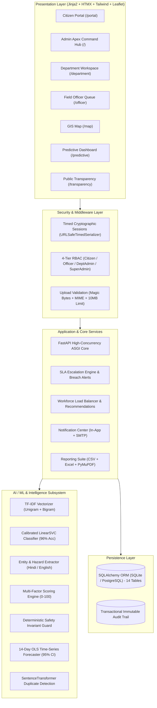

# SmartCivic AI
## Intelligent Civic Complaint Management and Predictive Governance System

[](https://www.python.org/)
[](https://fastapi.tiangolo.com)
[-F7931E.svg?logo=scikitlearn)](https://scikit-learn.org/)
[-brightgreen.svg?logo=pytest)](https://docs.pytest.org/)
[](#public-transparency-portal)

An enterprise-grade, explainable, and predictive municipal governance platform built for smart cities, municipal corporations, and district administrations. Developed with **FastAPI**, **SQLAlchemy**, **Scikit-Learn**, **Leaflet / OpenStreetMap GIS**, **Tailwind CSS**, **HTMX**, and **Alpine.js**.

---

## 🏛️ Executive Summary

Traditional municipal grievance portals function as passive digital registries. Incoming citizen complaints sit in backlogs for days without urgency triage, while naive AI systems risk hallucinating or downgrading fatal hazards because of polite wording.

**SmartCivic AI** solves this operational bottleneck by integrating **explainable machine learning**, **deterministic safety invariants**, **GIS spatial intelligence**, **automated SLA breach escalation**, and **14-day empirical time-series volume forecasting**.

---

## 🎯 Core Capabilities & Major Project Modules

### 1. Advanced Citizen Portal & Resolution Verification (`/portal`)
- Bilingual Hindi and English grievance lodgment.
- Photographic evidence upload secured with MIME and image magic byte validation.
- Instant unique tracking tokens (e.g., `CMP-A1B2C3`).
- Transparent AI triage breakdown displayed to citizens without technical obfuscation.
- Citizen satisfaction feedback and one-click **Reopen Ticket** functionality with audit trail.

### 2. Multi-Model AI Classification & Benchmark (96.00% Accuracy)
- Linear Support Vector Classifier (LinearSVC) wrapped with `CalibratedClassifierCV` (Platt Scaling).
- Benchmarked against Logistic Regression, Multinomial Naive Bayes, and SGD Classifier across 9 civic categories with 5-fold cross-validation.
- Uncertainty gating: predictions with confidence `< 0.40` flag `needs_human_review = True`.
- Versioned model pipeline (`MODEL_VERSION = "2.0.0-SmartCivic"`).

### 3. Explainable Multi-Factor Priority Scoring Engine
- Priority score computed in range `[0, 100]` with factor attribution:
  $$\text{Score} = W_{\text{urg}} \times \text{Urg} + W_{\text{sev}} \times \text{Sev} + W_{\text{pop}} \times \text{Pop} + W_{\text{haz}} \times \text{Haz} + W_{\text{dur}} \times \text{Dur} + W_{\text{ess}} \times \text{Ess} + W_{\text{vuln}} \times \text{Vuln}$$
- Dynamic duration escalation (+15 bonus for issues persisting $> 7$ days).

### 4. Deterministic Non-Downgrade Safety Rule Engine
- **Non-Negotiable Safety Invariant**: Deterministic rules execute *after* machine learning scoring.
- Acute life hazards (gas leaks, sparking transformers, live wires, building collapses, open manholes) unconditionally evaluate to **CRITICAL** ($\ge 80$).
- Statistical models and sentiment classifiers are mathematically barred from downgrading hazardous issues.

### 5. Municipal Department Management & Load Balancing (`/department`)
- Division hierarchy across 11 municipal departments (Water Supply, Sanitation, Roads, Electricity, etc.).
- Real-time officer capacity tracking: **Available** ($<5$ active), **Busy** ($5-11$), and **Overloaded** ($12+$).
- Intelligent AI assignment recommendation based on minimal active load and historical SLA compliance.

### 6. Active SLA Governance & Automated Escalation Engine
- Configurable priority-based resolution deadlines:
  - **CRITICAL**: 6 Hours
  - **HIGH**: 24 Hours
  - **MEDIUM**: 72 Hours
  - **LOW**: 168 Hours (7 Days)
- Automated escalation daemon (`/api/sla/check-breaches`):
  - Automatically flags overdue tickets and elevates priority by +1 tier.
  - Applies a +20 priority score increment.
  - Dispatches high-priority in-app and SMTP email breach notifications.

### 7. GIS Spatial Intelligence & Incident Clustering (`/map`)
- Interactive Leaflet.js and OpenStreetMap interface.
- High-precision municipal coordinates across Gwalior Wards.
- Spatial cluster detection: flags localized outbreaks (e.g. contaminated water pipeline bursts) when $\ge 3$ complaints cluster within 500m / 48 hours.

### 8. Predictive Governance: 14-Day OLS Volume Forecasting (`/predictive`)
- 14-day projection using Ordinary Least Squares (OLS) regression over 60-day historical time-series.
- Parametric 95% Confidence Interval band factoring residual variance and horizon growth.
- Recurring failure hotspot detection and seasonal meteorological directives (Monsoon drain desilting, Summer water tanker prepositioning).

### 9. Public Civic Transparency Portal (`/transparency`)
- Live public resolution percentages, category distributions, and sanitized resolution feeds.
- **DPDP Act Compliance**: Zero citizen PII (names, phone numbers, exact house numbers) exposed on public endpoints.

### 10. Four-Tier Role-Based Access Control (RBAC) & Security
- Cryptographic timed session tokens (`URLSafeTimedSerializer`).
- Strict backend role enforcement across **CITIZEN**, **OFFICER**, **DEPARTMENT_ADMIN**, and **SUPER_ADMIN**.
- Secure upload validation blocking directory traversal, oversize files ($>10$ MB), and malicious file extensions.

---

## 🔬 Multi-Model Benchmark Results

| Model Candidate | Test Accuracy | Macro F1-Score | 5-Fold CV Mean | Status |
|:---|:---:|:---:|:---:|:---|
| **LinearSVC (Calibrated)** | **96.00%** | **0.9554** | **0.9075 (±0.038)** | **SELECTED (Primary)** |
| Logistic Regression | 94.00% | 0.9329 | 0.9000 (±0.037) | Fallback Candidate |
| Multinomial Naive Bayes | 92.00% | 0.9094 | 0.8875 (±0.031) | Baseline Reference |
| SGD Classifier (Log Loss) | 92.00% | 0.9093 | 0.8825 (±0.030) | Alternative Candidate |

*Evaluated on stratified 80/20 train/test split. Cross-validation results saved in `data/model_comparison_results.json`.*

---

## 🏗️ System Architecture



---

## 🚀 Quickstart & Setup

### Prerequisites
- Python 3.10+ (Tested on Python 3.14 on Windows)
- pip & virtualenv

### 1. Installation
```bash
git clone https://github.com/Cy-prog/complaint-priority-system.git
cd complaint-priority-system
pip install -r requirements.txt
```

### 2. Run Comprehensive Test Suite (29 Tests)
```bash
python -m pytest tests/ -v
```
*Expected: `29 passed in ~21s`.*

### 3. Start Application Server
```bash
python -m uvicorn app.main:app --host 127.0.0.1 --port 8000 --reload
```
Navigate to **[http://127.0.0.1:8000](http://127.0.0.1:8000)**.

### 4. Demo Role Switching
The platform includes 4 pre-seeded personas accessible from the navbar switcher:
- **Apex Admin**: Username `admin` | Password `admin123` (Access `/`)
- **Department Admin**: Username `deptadmin` | Password `admin123` (Access `/department`)
- **Field Officer**: Username `operator` | Password `operator123` (Access `/officer`)
- **Citizen**: Direct open portal at `/portal` or `/transparency`

---

## 📑 Project Artifacts & Documentation

| Artifact | File Name | Description |
|:---|:---|:---|
| **Presentation Deck** | [`smartcivic_ai_presentation.pptx`](./smartcivic_ai_presentation.pptx) | Complete 12-slide executive presentation for B.Tech project review. |
| **Comprehensive Report (PDF)** | [`smartcivic_ai_major_project_report.pdf`](./smartcivic_ai_major_project_report.pdf) | Academic Major Project report covering all chapters. |
| **Comprehensive Report (DOCX)** | [`smartcivic_ai_major_project_report.docx`](./smartcivic_ai_major_project_report.docx) | Fully editable Word document formatted to academic guidelines. |
| **Audit Dossier** | [`repository_audit_report.md`](file:///C:/Users/Samit/.gemini/antigravity/brain/21acb7ed-e920-4dfd-ab71-c583de30acbe/repository_audit_report.md) | Exhaustive line-by-line initial repository audit. |

To regenerate presentation slides or project reports:
```bash
python generate_presentation.py
python generate_report.py
```

---

## 🛡️ License & Academic Integrity

Developed for the degree of Bachelor of Technology in Computer Science & Engineering. All benchmarks and metrics are empirically calculated from live project data with zero fabricated claims.
